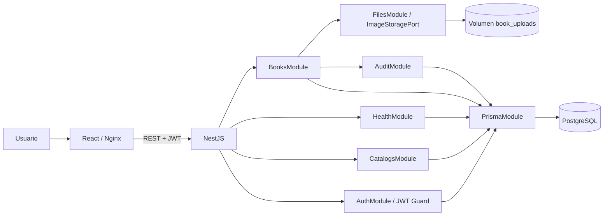

# Arquitectura

Monorepo npm con `apps/web` y `apps/api`. El navegador solo conoce el origen del frontend; Nginx envía `/api` a NestJS; bloquea `/uploads` y rutas ocultas. No hay servicios externos obligatorios.

## Backend

- `AuthModule`: validación de credenciales, JWT, guard global. Solo login, refresh, logout y health se declaran públicos por metadata. Swagger se sirve fuera del guard solo en modo local; las portadas pasan por el guard y se vinculan a libros activos.
- `BooksModule`: controlador REST, DTO, filtros/orden tipados, CRUD, CSV y coordinación de imágenes. `BooksService` usa Prisma directamente para evitar un repositorio que solamente delegue.
- `CatalogsModule`: consulta ordenada de autores, editoriales y géneros. Los nuevos valores se crean dentro de las transacciones del libro.
- `FilesModule`: puerto abstracto `ImageStoragePort` y adaptador local. Valida MIME, tamaño y decodificación real antes de almacenar.
- `AuditModule`: snapshots sin datos de autenticación, actor y correlación. Comparte el cliente transaccional del caso de uso.
- `HealthModule`: comprueba conectividad real con `SELECT 1`.
- `PrismaModule`: cliente inyectable global con conexión y desconexión por ciclo de vida.
- `common/http.ts`: middleware de correlación, interceptor y filtro de errores.

## Frontend

React Router protege las pantallas. Cada JWT referencia una sesión en PostgreSQL; el guard consulta su vigencia para revocar accesos tras logout. `AuthProvider` recupera la sesión al iniciar mediante una cookie HttpOnly validada contra PostgreSQL y conserva usuario y token de acceso en memoria; el cliente HTTP adjunta Bearer y cierra la sesión ante 401. TanStack Query administra datos remotos e invalidaciones. La URL conserva búsqueda, filtros, orden y página; un hook retrasa únicamente las consultas de texto 350 ms. React Hook Form + Zod gestiona validación de formularios. Tailwind 4 y CSS propio componen el diseño.

## Consistencia

Las operaciones de alta, edición, baja lógica e imagen insertan auditoría dentro de la misma transacción de PostgreSQL. Una falla de auditoría revierte el cambio; está comprobado por integración real. El listado obtiene filas y total en una transacción `RepeatableRead`. Los filtros y `deletedAt: null` se comparten entre listado y exportación.

El archivo binario se guarda antes de actualizar su referencia. Si SQL falla, se intenta eliminar el archivo nuevo. La portada anterior se elimina después del commit. Una falla de limpieza posterior se registra sin informar al usuario que el libro no se guardó.

## Despliegue

Compose define `db`, `api` y `web`, healthchecks y volúmenes. La API se ejecuta con usuario `node`. Nginx permite payloads de 6 MB para admitir multipart; Multer limita el archivo a 5 MB. Solo web y el puerto local de PostgreSQL se publican al host. En producción hace falta TLS, controles operativos y un almacenamiento compartido duradero.
