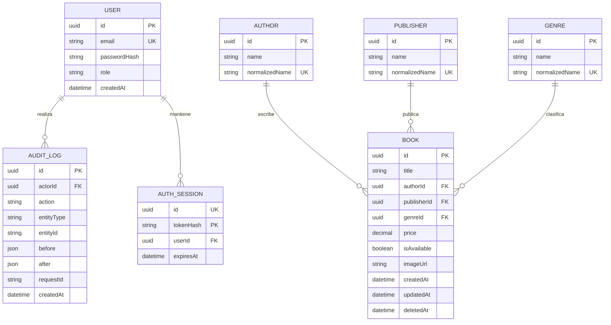

# Modelo relacional

El esquema ejecutable está en `apps/api/prisma/schema.prisma`; la migración inicial en `apps/api/prisma/migrations/202610220001_init/migration.sql`.

UUIDs para identificadores, `Decimal(12,2)` para precio y JSONB para snapshots. El `CHECK` SQL impide precios negativos incluso fuera de la API. `updatedAt` lo actualiza Prisma. `deletedAt` conserva el registro pero lo excluye de consultas de libros.

Índices: email único, nombres normalizados únicos, compuestos `(deletedAt, authorId)`, `(deletedAt, publisherId)`, `(deletedAt, genreId)`, `(deletedAt, isAvailable)`, `(deletedAt, price)` y fecha de auditoría. La igualdad de `deletedAt` acompaña los filtros normales. Antes de aumentar índices se deben medir planes con `EXPLAIN ANALYZE`.

No existe unicidad por título: pueden coexistir ediciones o libros homónimos. Los catálogos sin libros activos siguen apareciendo como opciones; no se eliminan automáticamente.

El seed usa IDs fijos para 24 libros de demostración. Un segundo seed no sobrescribe ediciones ni vuelve a mostrar libros retirados. La cuenta se crea si no existe; su contraseña no se resetea en cada arranque.

`AuthSession` se incorpora en la migración `202610220002_auth_sessions`: hash SHA-256 como clave, FK al usuario con borrado en cascada e índices por usuario y vencimiento. No almacena el secreto en claro.

La migración `202610220003_session_id` agrega un UUID único a cada sesión. Ese identificador se incorpora como `sid` en JWT para revocación; el hash del secreto de recuperación no se expone como identificador del token.
